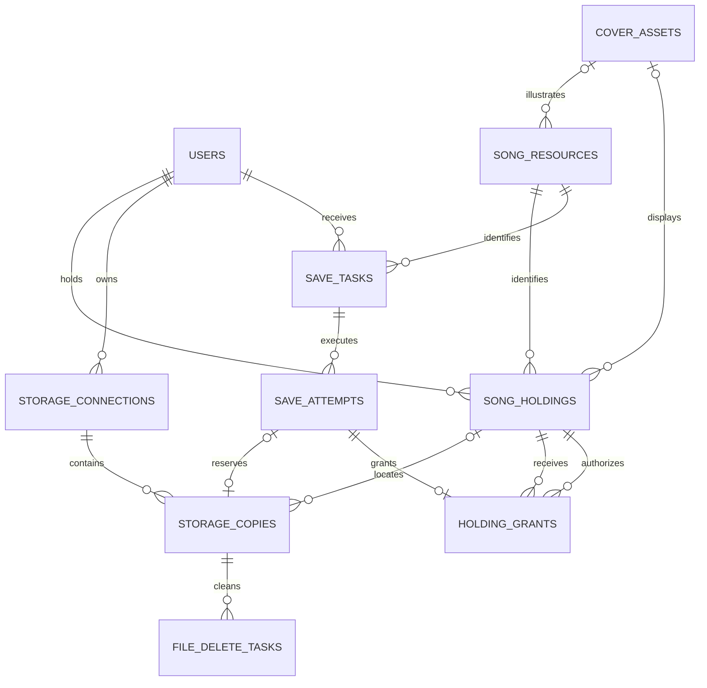

# 技术方案与歌曲数据模型

本文对应 [Issue #1](https://github.com/yuudi/cloudmusic/issues/1)，确定个人播放及后续转存的数据边界。产品规则见 [README](README.md)，分享会规则见 [party-mode.md](party-mode.md)。

本文是设计交付，不代表相关功能或业务表已经实现；本次不添加数据库迁移。0.1 实现个人歌曲、持有记录和存储来源，0.2 实现好友权限、转存及授权追溯。后续多副本、重复转存和授权撤销仅保留扩展空间。

## 已确定的规则

- 用户主动导入，不检查文件内容或计算音频内容哈希来去重。当前按存储连接与文件路径识别重复导入；不同路径视为不同文件，不同连接之间不识别同一远端文件。
- 同一连接、同一路径已有未移除的来源或正在写入的任务时，拒绝重复导入。来源暂时不可读取或已失效不解除路径占用。并发请求由数据库唯一约束兜底。
- 每次独立导入创建新的歌曲资源，包括不同用户导入内容相同的文件。转存他人歌曲沿用原歌曲资源身份，创建保存者自己的持有记录和存储副本。
- 标题、歌手、专辑等可编辑元数据属于用户持有记录。导入时从文件提取；转存时复制分享者在本次转存开始时的数据；此后各自修改，不同步，不沿上游关系查询，不写回网盘文件。
- 封面仍只从文件提取，不允许用户修改。相同歌曲的持有记录可以引用同一份不可变封面对象，不必重复上传到封面 S3。
- 从曲库删除默认不删除网盘文件，用户可以显式选择同时删除。删除曲库记录立即关闭该持有者的播放分享和转存入口，不影响其他已成功保存者取得的权利和自己的文件。
- 删除后允许重新导入同一路径，重新导入创建新的歌曲资源。原持有记录及转存历史保留，不把新资源与旧资源合并。
- 同一用户对同一歌曲资源最多成功转存一次，删除曲库记录不清除这段成功历史。换分享者或切换默认网盘不能绕过限制。失败可以重试，不算成功转存。
- 更换来源是修复已有歌曲的存储位置，保留歌曲身份、用户元数据和权利；不能通过更换来源改变歌曲内容或升级权利。普通重新导入创建新资源。
- 转存只在实际开始复制时检查一次权限。开始后分享者关闭分享或删除曲库记录，不撤销本次已取得的转存许可；远端文件被删、授权失效等仍可能导致实际复制失败。
- 转存成功后的权利独立于分享者。当前不实现授权撤销，但保留上游持有记录引用及授权快照。

## 技术选型与状态归属

### PostgreSQL、GORM 与 Goose

沿用现有 PostgreSQL 数据库和 GORM 查询层。用户、歌曲资源、持有关系、用户元数据、权利和分享设置、存储连接、存储副本、保存任务及其恢复信息均持久化到 PostgreSQL。正确性不依赖 Redis 键或本地音频缓存保留。

GORM 用于查询和短事务，不通过服务启动时的 `AutoMigrate` 修改表结构。Goose 执行版本化 SQL，迁移嵌入独立迁移程序；部署时先运行迁移，再启动服务。保留已执行的 `00001_placeholder.sql`，在后续功能任务中新增编号迁移；不重写历史迁移，也不通过重置开发数据库交付模型变更。

业务表采用应用生成的 UUID 主键，时间使用 `timestamptz`，文件大小、偏移和毫秒时长使用非负 `bigint`。权利和状态使用文本列配合 `CHECK` 约束，便于后续通过迁移扩展。外键、唯一约束和必要的复合外键负责持有归属及并发不变量；涉及多个表的有效性检查放在短事务中完成。

不引入树结构扩展。转存来源是审计关系，日常元数据读取不需要递归继承。

### Redis 与临时磁盘

| 状态                                               | 保存位置             | 丢失后的行为                         |
| -------------------------------------------------- | -------------------- | ------------------------------------ |
| 持有关系、用户元数据、权限、授权历史               | PostgreSQL           | 从持久数据库读取和恢复               |
| 存储凭据及刷新后的令牌                             | PostgreSQL，加密保存 | 不能依赖 Redis 恢复凭据              |
| 保存任务、执行尝试、清理任务、持久重试时间         | PostgreSQL           | 进程重启后重新认领                   |
| 音频缓存索引、可用区间、最后访问时间、临时协调状态 | Redis                | 将不确定的缓存视为未命中，重新回源   |
| 音频缓存内容                                       | 可丢弃的临时磁盘     | 缺失时回源；文件存在也不证明区间可用 |
| 不可变封面对象                                     | 主服务使用的 S3      | PostgreSQL 保存对象引用及提取状态    |

Redis 可以加速调度唤醒或减少重复工作，但不是成功转存、任务归属或授权的唯一依据。任务执行权使用 PostgreSQL 的认领、租约及执行代次维护。Redis 不保存音频内容，不把缓存区间逐条写入业务数据库。

Redis 索引与磁盘文件必须属于同一缓存实例代次。索引丢失、文件缺失或代次不匹配时按未命中处理，不能按残留文件长度重建命中状态。索引与数据均可丢弃；跨重启复用的验证留给 #24。

## 实体与关系

“歌曲所有者”在此表示持有该资源的用户，不代表该用户一定取得了产品规则中的“所有权”。一个只有播放权的用户同样有持有记录。

图中的存储副本在复制期间可以尚未关联持有记录；成功入库后必须关联。表名及以下字段是逻辑设计，实际 DDL 随功能实现补齐。

### 歌曲资源：`song_resources`

| 主要字段                           | 含义                                                                   |
| ---------------------------------- | ---------------------------------------------------------------------- |
| `id`                               | 歌曲资源身份；不从文件路径、文件哈希或元数据推导                       |
| `created_by_user_id`、`created_at` | 首次独立导入的用户和时间                                               |
| `cover_asset_id`                   | 首次导入时可为空的不可变封面引用，作为资源原始信息保留                 |
| `original_metadata`                | 首次从文件提取的只读元数据基线，便于追溯，不作为个人编辑数据的动态兜底 |

资源不直接保存某个用户的分享设置、默认播放位置或凭据，也不把文件大小、格式及来源健康状态视为所有副本共用的属性。

资源被持有记录或历史授权引用时保留。移除某个用户的歌曲不级联删除资源、封面或其他用户的持有记录。未来的孤立资源与封面回收须检查全部引用，另行实现。

### 封面对象：`cover_assets`

记录 `id`、S3 对象键、媒体类型、提取状态及时间戳。上传完成的对象不可变，更新提取结果时使用新对象身份；无封面与提取失败分开记录。封面引用不携带任何存储连接凭据，对外获取封面仍按相应歌曲入口的访问权限处理。

封面 S3 与用户歌曲来源、可选的独立 Cloud Music 歌曲存储分别管理。复制封面引用不等于复制音频文件，也不构成音频内容去重。

### 用户持有记录：`song_holdings`

| 主要字段                                 | 含义                                                                             |
| ---------------------------------------- | -------------------------------------------------------------------------------- |
| `id`、`song_id`、`user_id`               | 独立的持有记录身份、歌曲资源和持有者                                             |
| `acquired_via`                           | `import` 或 `save`                                                               |
| `rights`                                 | `playback` 或 `ownership`，表示当前取得的权利                                    |
| `title`、`artists`、`album` 等           | 用户自己的完整元数据，可为空或空数组；不是上游字段的覆盖层                       |
| `cover_asset_id`                         | 导入时取得或转存开始时复制的不可变封面引用；缺少时展示占位符，不跟随其他用户变化 |
| `play_scope`、`save_scope`               | 分别为 `private`、`friends`、`public`；新记录默认 `private`                      |
| `save_grant_rights`                      | 允许别人保存时授予的权利；未开启保存分享时可为空                                 |
| `created_at`、`updated_at`、`deleted_at` | 生命周期；删除只作逻辑标记                                                       |

约束与查询规则：

- `UNIQUE (song_id, user_id)` 覆盖已删除记录，保证当前每用户每资源只有一条持有关系，也保留已成功保存的事实。
- `rights = playback` 时禁止 `play_scope = public`，且 `save_scope` 必须为 `private`；只有 `ownership` 才可开启转存并选择授予的权利。
- 删除记录无论原分享设置是什么，都不能作为新的播放分享或转存入口。鉴权必须检查 `deleted_at`，不能只看分享字段或缓存是否命中。
- 导入由用户声明权利；转存由开始时的授权快照确定权利，不接受保存者自行升级。来源修复和元数据修改均不改变权利。
- 持有记录及权限不随上游记录变更自动更新。用户自己的元数据直接从本记录读取；清空字段就保存空值，不恢复上游继承。
- 个人曲库按 `user_id` 和未删除条件读取；常用索引为未删除记录上的 `(user_id, created_at, id)`。元数据搜索和排序直接使用个人字段，索引按 #6 的查询需求添加。

用户和歌单的完整模型分别由 #2 和 #6 实现。歌单条目应引用本用户的持有记录，而非只引用歌曲资源，防止混入其他人的权利、元数据或来源；删除持有记录时移除对应有效歌单条目。好友关系和分享访问由 #15 至 #17 实现。

### 存储连接：`storage_connections`

| 主要字段                                | 含义                                     |
| --------------------------------------- | ---------------------------------------- |
| `id`、`user_id`                         | 连接身份和所属用户                       |
| `backend_type`、`display_name`          | 存储后端和展示名称                       |
| `public_config`                         | 不含秘密的后端配置，例如端点、桶和根目录 |
| `encrypted_credentials`、`key_version`  | 加密凭据、OAuth 令牌和加密密钥版本       |
| `config_version`、`credentials_version` | 来源命名空间及凭据更新的并发控制版本     |
| `status`、`deleted_at`                  | 授权、连接及逻辑移除状态                 |

每个连接只属于一个用户。默认外部存储连接由用户设置引用，必须属于本人且可写；临时的远端不可达不清除该设置，但实际保存可能失败。独立 Cloud Music 歌曲存储不能作为转存目标。

刷新令牌在数据库中加密持久化，以连接级锁或版本条件更新防止并发覆盖。加密主密钥通过部署环境注入，不写入数据库明文配置或日志；密钥配置和备份说明由 #14 补齐，OAuth 范围与刷新流程由 #4 验证。

重新授权同一连接可更新凭据。改变端点、账号、桶或根目录等导致路径实际指向另一个命名空间时，创建新连接并显式修复来源，不能静默把旧副本指向新位置。逻辑移除连接不级联删除副本或历史位置；重新授权、断开及远端失效应与歌曲是否从曲库删除分开。

### 存储副本：`storage_copies`

| 主要字段                                                               | 含义                                                                                                                                          |
| ---------------------------------------------------------------------- | --------------------------------------------------------------------------------------------------------------------------------------------- |
| `id`、`song_id`、`user_id`、`holding_id`                               | 副本身份、资源、所属用户及持有记录；导入预留时 `song_id`、`holding_id` 可为空，保存复制时仅 `holding_id` 可为空；失败历史保留当时已取得的关联 |
| `connection_id`、`path_key`、`display_path`                            | 所属连接、用于唯一约束的路径和用于展示的原位置                                                                                                |
| `provider_file_id`                                                     | 后端支持时记录稳定文件标识；不替代导入路径去重规则                                                                                            |
| `state`                                                                | `reserved`、`copying`、`ready`、`connection_failed`、`invalid`、`retired`、`deleted`                                                          |
| `size_bytes`、`duration_ms`、`format`、`codec`、`bitrate`              | 此文件实际技术属性，不随用户修改标题等描述数据而改变                                                                                          |
| `source_generation`                                                    | 来源修复或检测到文件变化时递增，隔离旧缓存                                                                                                    |
| `first_failed_at`、`failure_count`、`retry_count`、`next_retry_at`     | 按副本持久保存来源失败与重试状态                                                                                                              |
| `released_at`                                                          | 何时解除路径占用；失败或失效本身不解除占用                                                                                                    |
| `reservation_kind`、`reservation_expires_at`、`reservation_generation` | 区分导入和保存预留，识别未完成导入的过期预留并排除旧执行者提交                                                                                |

副本与连接、持有记录、保存任务的用户归属必须一致；副本与持有记录、保存任务指向同一歌曲资源，以复合外键或事务检查保证。尚未成功导入或保存的预留及失败历史允许缺少上述关联；进入 `ready` 等可用于播放或来源重试的状态前必须已绑定歌曲及持有记录。对 `connection_id`、`holding_id` 的反向查询及待执行 `next_retry_at` 建立索引。

核心路径约束通过部分唯一索引表达：`UNIQUE (connection_id, path_key) WHERE released_at IS NULL`。导入和转存都先原子预留路径，避免相互覆盖。该唯一性只在一个连接内生效，不根据内容、文件大小或跨连接的后端文件标识合并。

`path_key` 由存储适配层按照后端路径语义生成：相对于连接根目录，保留有意义的大小写、空格和对象键字符，不统一套用本地文件系统的大小写折叠或路径清理。适配层应将同一后端认定的等价路径转换为同一键，具体行为在 #3 按后端验证。

0.1 每条有效持有记录选择一个当前副本，可用未退休副本上的 `holding_id` 部分唯一索引约束。来源失败或失效仍是当前副本；未完成复制的路径预留不提供播放。表关系采用一对多以保留修复历史，并允许未来通过迁移取消单个当前副本的限制。

更换来源时验证新位置、技术属性及用户确认，在短事务中切换当前副本并退休旧副本。普通修复不删除旧网盘文件。旧位置和失败记录保留用于历史，旧缓存代次失效；不能把新旧文件的缓存区间拼接。具体验证不引入内容哈希去重，也不声称大小、时长相同就能证明歌曲内容相同。

来源失败的调度遵循产品文档：首次失败后立即、10 分钟、1 小时、1 天和 7 天各重试一次。读取成功可恢复来源状态；缓存命中不能证明来源恢复。手动重试与自动计数关系由 #13 细化。

### 保存任务与执行尝试：`save_tasks`、`save_attempts`

`save_tasks` 表示用户希望成功保存某个资源，`save_attempts` 表示一次实际执行及其固定输入。失败重试新增尝试，不覆盖先前授权或清理信息。

| 实体                     | 主要字段                                                                                                                        | 约束及用途                                                                                                    |
| ------------------------ | ------------------------------------------------------------------------------------------------------------------------------- | ------------------------------------------------------------------------------------------------------------- |
| `save_tasks`             | `id`、`song_id`、`recipient_user_id`、`requested_source_holding_id`、`state`、`current_attempt_id`、`result_holding_id`、时间戳 | `UNIQUE (song_id, recipient_user_id)`；记录待执行请求选择的分享者入口，重复请求返回已有状态，成功后不重新执行 |
| `save_attempts`          | `id`、`task_id`、`attempt_no`、`state`、`lease_owner`、`lease_expires_at`、`execution_generation`                               | `UNIQUE (task_id, attempt_no)`；认领、恢复及排除旧执行者提交                                                  |
| 尝试中的来源快照         | `source_holding_id`、`source_user_id`、`source_copy_id`、来源连接及位置、`source_generation`                                    | 保存本次实际读取的来源，不在复制中途自动切换分享者或其他副本                                                  |
| 尝试中的授权快照         | `authorized_at`、分享者权利、保存范围、授予权利、规则版本                                                                       | 实际开始复制时固定，不在结束时重新检查分享权限                                                                |
| 尝试中的目标和元数据快照 | 目标连接及路径、预留副本引用、分享者当时的个人元数据和封面引用                                                                  | 默认网盘或分享者元数据后续变化不影响本次尝试                                                                  |
| 尝试中的恢复信息         | `heartbeat_at`、已知写入位置或对象标识、失败分类、清理状态、完成时间                                                            | 能识别本次产生的文件并恢复或清理，不能只保存在进程内存                                                        |

只有任务进入执行并取得授权快照后才允许访问上游进行复制。排队和客户端提交请求本身不取得永久许可；`pending` 任务恢复后首次开始执行仍需检查权限。

任务状态为 `pending → running → succeeded`；执行失败需要清理时经过 `cleanup_pending` 再进入 `failed`，没有残留则可直接失败。清理失败保留待清理状态，不能当作已经清理完毕；失败后显式重试回到 `pending` 并新增尝试。每次尝试的成功或失败结果保留，不把旧尝试重置成新尝试。调度按任务状态及尝试租约到期时间建立索引，认领和成功提交均检查当前尝试身份及执行代次。

已开始的同一次尝试因进程崩溃而恢复，沿用其授权快照，不重新检查分享者权限。若后端不支持安全续传，可以清理后重新完整复制，但不得改变本次来源和目标。失败终结后用户重新发起重试，则创建新尝试，并重新检查当时的权限和目标设置。重复点击或任务仍在执行时不创建第二个并发尝试。

执行租约到期不等于旧执行者已停止远端写入。实现 #18 时必须同时落实数据库提交代次检查，以及不覆盖其他尝试文件的写入隔离和清理规则；只依靠 Redis 锁或租约不构成安全的任务恢复。各后端的临时文件、续传、重命名和复制能力由 #3 验证，具体实现留给 #18。

### 成功授权记录：`holding_grants`

| 主要字段                                                    | 含义                                             |
| ----------------------------------------------------------- | ------------------------------------------------ |
| `id`、`song_id`、`recipient_holding_id`                     | 此次授权身份、歌曲资源和取得权利的持有记录       |
| `source_holding_id`、`source_user_id`                       | 直接从哪个持有记录、哪个用户处保存               |
| `save_attempt_id`                                           | 唯一指向一次成功执行及其开始时快照               |
| `granted_rights`、`authorization_snapshot`、`authorized_at` | 当时获得的权利及依据                             |
| `created_at`                                                | 成功保存并写入授权记录的时间，与开始授权时间分开 |

成功授权记录追加后不因分享设置变化而改写。任务、来源持有记录和目标持有记录必须指向同一歌曲资源。源记录逻辑删除不会破坏外键，收件人之后删除曲库记录也不删除授权历史。

通过“目标持有记录 → 授权记录 → 来源持有记录”可以追溯 A → B → C 的保存链。日常播放和元数据展示只使用当前持有者的数据与权利，不沿链实时鉴权。历史快照是审计事实，不是上游可变分享设置的引用。

独立授权表可以在未来支持一个持有关系对应多次授权。当前仍受一次成功转存约束；不预先实现授权合并、升级、撤销级联或跨分享者自动择优。

### 远端删除任务：`file_delete_tasks`

用户选择删除网盘文件，或保存失败需要清理本次残留时，均需持久记录待清理工作。字段包括 `id`、`copy_id`、可选 `save_attempt_id`、删除原因、固定连接与位置、对象标识或可用版本信息、状态、租约及执行代次、重试信息和错误分类。相同删除操作重复提交返回已有任务。

曲库删除的短事务先标记持有记录已删除、关闭入口、移除有效歌单条目，并按用户选择创建删除任务。远端删除在事务外执行；远端删除失败不恢复曲库可见性，也不影响其他持有者。任务必须保留结果供用户查看或重试。

不删除网盘文件时，退休副本并解除路径占用，允许立刻重新导入。选择删除网盘文件时，在删除确认完成前保留路径占用，防止重新导入后被旧任务误删；删除失败或仍需重试不解除占用，确认完成后才允许重新导入。来源失效不等于已经确认远端文件不存在。若后续提供取消删除功能，只有确认旧执行者不会再执行远端删除，才可以释放路径。

执行前检查路径仍属于本次删除操作，并尽可能利用后端对象标识或条件操作，不能只用一个历史路径任意删除。平台无法阻止用户在网盘端并发替换文件；后端不提供安全识别能力时，不应盲目重试删除无法确认归属的文件，具体恢复行为由 #18 和存储适配实现细化。

## 关键流程与事务边界

### 独立导入

1. 验证用户有权使用该存储连接，以连接与路径预留副本；冲突就拒绝，不读取内容做去重。
2. 在事务外读取技术属性、元数据和文件内封面，验证 #8 确定的格式范围。导入不转码，也不修改源文件。
3. 用短事务创建新歌曲资源、该用户的持有记录和元数据，绑定预留副本并使其可播放。导入者声明权利，分享默认关闭。
4. 失败时不留下有效持有记录，释放本次导入预留。导入从未写入源文件，失败不能删除用户已有的文件；未被引用的临时封面可清理。未完成预留须能根据持久状态被重新认领或过期回收。

删除后重新导入走相同流程，使用新的资源、持有记录和副本身份。即使路径和内容相同，也不恢复旧资源的分享或授权链。

### 保存他人歌曲

1. 以 `(song_id, recipient_user_id)` 原子创建或获取任务。有成功保存或已有该资源持有关系时返回已有结果，包括记录已删除的状态，不恢复曲库也不进行第二次复制；失败任务可以申请新的执行尝试。
2. 开始复制前，用短事务锁定任务及相关持有、分享记录，检查来源仍未删除、分享者允许保存、保存者满足访问范围，并有本人可写的默认外部网盘。并发关闭分享或删除通过相同持有记录的事务锁确定先后：先完成授权则本次继续，否则拒绝。
3. 固定本次来源、目标、授权、元数据及封面快照，预留目标路径并建立执行尝试。成功提交这个事务标志着本次转存获得许可；网络复制在事务外执行。
4. 复制完成后，用短事务检查本次执行代次、目标预留和任务尚未成功提交，创建保存者的持有记录、成功授权记录及有效副本，一并标记任务成功。此处不重新检查分享者是否删除或修改权限，不依赖其曲库仍然有效。
5. 失败保留任务及尝试记录，只清理本次写入文件。清理未完成前不启动会与残留路径冲突的新尝试，也不清除执行来源和授权快照。远端已复制、数据库尚未确认的崩溃情况须先认领并核对本次尝试，避免重复创建持有关系或误删已成功文件。

成功持有记录是曲库可见的前提。任务创建、授权通过、文件开始写入都不表示已取得成功保存记录；唯一约束与短事务共同保证并发请求最多提交一个成功结果。

### 个人播放及来源修复

1. 从本用户持有记录或请求明确指定的分享持有记录判断访问权限；缓存命中也不跳过鉴权。
2. 本人已有该歌曲的保存关系时，只使用自己的有效副本。自己的记录已删除、文件不可读或失效都不能自动回退到其他所有者文件。只有尚未持有该歌曲时，才按分享者入口读取其副本。
3. 确定具体副本及缓存代次，再判断所需区间是否已完整缓存；未命中才访问来源。缓存命中不触发远端检查，也不自动清除数据库中的来源失败状态。
4. 来源修复切换副本，保留持有身份、个人元数据、权利和授权记录；新副本独立校验和缓存。分享会的统一来源例外由 #20 至 #22 处理。

## 缓存索引边界

缓存身份至少包含缓存实例代次、具体存储连接、文件标识或路径以及来源代次；不同用户、不同存储副本不能仅因 `song_id` 相同而共用音频缓存。

索引记录临时文件位置、来源技术属性、已提交可读区间、下载中/部分/完整/失败状态、最后读取时间、过期信息及临时读写占用。只有写入完成且能够读取的区间才能发布为可用。并发读写必须符合 #11，不以文件存在或预分配长度作为命中依据。

访问上游时按文件大小和时长进行既定宽松校验，任一改变则旧缓存失效并切换来源代次。大小和时长相同也不构成内容去重或严格内容一致性的承诺。用户修改标题等平台元数据不改变物理来源属性或缓存身份。

时间过期默认按“最后一次读取时间 + 文件实际时长 + 额外保留时间”计算，额外保留时间默认 60 分钟；容量默认 10GB，磁盘预留默认 10GB。前两项可配置为无限，磁盘预留始终生效，容量压力下按 LRU 清理不在读取中的缓存。超过限制时的在线降级由 #12 确定，不能在此模型中假定缓存写入一定成功。

## 扩展与实施边界

| 内容               | 当前设计保证                                           | 后续任务                                         |
| ------------------ | ------------------------------------------------------ | ------------------------------------------------ |
| 账号、游客及清理   | 业务记录引用用户身份，避免清理时误删仍被引用的授权历史 | #2 确定账号清理及身份保留方式                    |
| 存储及凭据         | 用户隔离、加密持久化、位置和副本分离                   | #3、#4 验证后端能力及 OAuth                      |
| 曲库和歌单         | 个人元数据独立，条目引用本人持有记录                   | #5、#6 落实导入、元数据与歌单                    |
| 个人播放和缓存     | 按具体副本读取，缓存可丢失且不能绕过鉴权               | #8 至 #13 验证播放、实现转发和恢复               |
| 转存及一次成功限制 | 固定授权快照，数据库认领和唯一约束，保留成功历史       | #16、#18、#19 实现权限及任务流程                 |
| 多副本与再次转存   | 副本与持有分离，授权独立成表，历史不覆盖               | #25 决定来源选择、唯一约束调整及权利合并         |
| 授权撤销           | 保留直接上游、规则和权利快照，可追溯保存链             | #29 定义撤销范围、传播和历史兼容；当前不执行撤销 |
| 多实例及重启复用   | 持久业务状态在 PostgreSQL，Redis 和本地缓存可丢失      | #24、#30 验证缓存复用及跨实例协调                |

未来允许再次保存时，保留每用户每资源的持有关系身份，通过新增副本和授权记录表达多次取得。需要重新设计 `save_tasks` 的去重维度、取消单当前副本限制并明确权利合并规则，不能只删除唯一约束就上线。未来撤销也不能通过当前查询动态继承上游权限来实现，必须先确定新的产品规则及历史授权兼容策略。

## 设计验收场景

以下是后续实现应覆盖的行为示例，本次只检查设计一致性，不声称已经运行这些功能测试。

| 场景                                     | 应有结果                                                          |
| ---------------------------------------- | ----------------------------------------------------------------- |
| 同连接同路径并发导入                     | 最多一个预留成功，其余拒绝重复导入                                |
| 内容相同但路径不同，或由不同用户独立导入 | 创建不同歌曲资源，不做内容去重                                    |
| A → B → C 依次转存，B 修改元数据         | 三者共享歌曲资源，各自元数据独立；C 只在其转存开始时取得 B 的快照 |
| A 修改元数据或撤销分享                   | 已成功保存的 B 不同步元数据，不丢失已经取得的权利                 |
| A 删除曲库记录，B 尚未开始转存           | 不能从 A 处开始新转存                                             |
| B 已通过开始授权，A 随后删除或关闭分享   | B 可以继续；仅因实际读取或写入失败等原因失败，不在结束时重新鉴权  |
| B 获得所有权后 A 删除歌曲                | B 可按自己的设置继续分享，其他用户仍可从 B 处保存                 |
| 保存者修改默认网盘或从另一分享者重复保存 | 已成功任务返回原状态，不生成第二份副本或升级权利                  |
| 保存成功后删除曲库记录，再次保存同一资源 | 保留成功历史，拒绝第二次转存                                      |
| 删除曲库时未选择删除文件，再导入同一路径 | 允许导入，创建新资源，不复活旧分享和授权链                        |
| 选择删除文件但删除任务尚未完成           | 曲库入口已关闭，路径仍被占用，不允许新导入被旧任务删除            |
| 更换来源或标题发生变化                   | 前者切换副本并隔离缓存；后者只修改个人数据库字段                  |
| Redis 或临时磁盘数据丢失                 | 持有关系和任务不丢失；缓存按未命中回源，不根据残留文件猜测区间    |
| 进程重启、重复请求或租约过期             | 依据 PostgreSQL 任务状态认领，旧执行者不能重复提交成功记录        |
